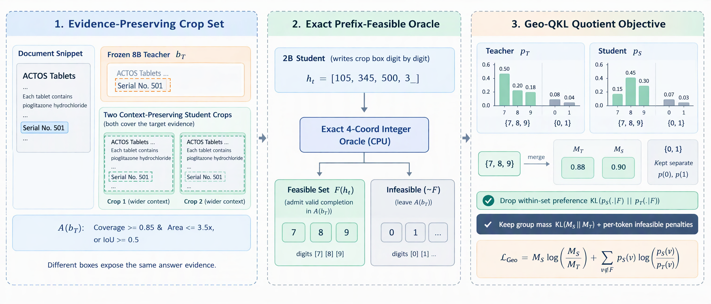
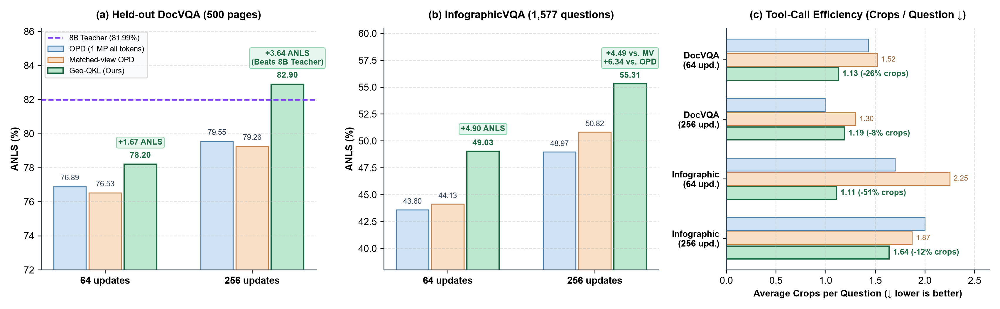
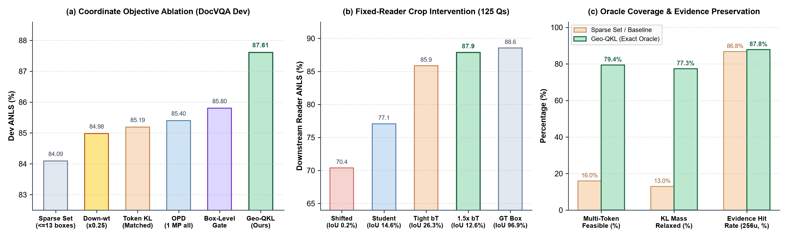

# Geo-QKL：零标注、2B 反超 8B 教师的视觉文档智能体精确可行集蒸馏



**一句话简介**：**Geo-QKL** 面向高分辨率视觉文档智能体（`Qwen3-VL-8B-Instruct` 蒸馏 `Qwen3-VL-2B-Instruct`），**既不需要任何人工标注框或标准答案标签，也不增加任何可训练参数**，仅靠**读写视图对齐（Matched-view OPD）+ 四坐标精确整数几何 Oracle + 商空间逆向 KL（Quotient Reverse KL）**，在**最高减少 51% 裁剪工具调用**的前提下，让 **2B 学生在 DocVQA 上以 1/4 参数量反超 8B 教师（`82.90% vs. 81.99%`）**，在细长密集的 InfographicVQA 上暴涨 **+4.5～+6.3 个点**，并在自然图像高分辨率零样本迁移四榜上拿下最高均分（**`50.4%`**）。

---

## 一、Motivation（为什么要做 Geo-QKL？）

高分辨率文档（DocVQA）和信息图（InfographicVQA）缩放到全局概览预算（`0.25 MP`）后，细小文字和密集表格数字会模糊丢失。视觉智能体通过“看 `0.25 MP` 低清概览 $\to$ 发出裁剪工具调用 `[x1, y1, x2, y2]`（`0..1000` 整数网格）$\to$ 切取 `1.0 MP` 高清局部图拼回上下文 $\to$ 最多裁剪 3 次后作答”来读取证据。但在无标注蒸馏裁剪智能体时，现有路线各自卡在一个致命痛点上：

1. **标准逐词在线蒸馏（Token-level OPD）——把“取证动作”当成了“死板的文本抄写”**
   - 直接把 `[x1, y1, x2, y2]` 的每个坐标数字当成普通文本 token，强迫学生复刻教师在每一位数字上的完整概率分布。
   - **痛点**：**裁剪框是“获取证据的动作（Evidence-Acquisition Action）”，不是单目标检测框**。只框住 `"501"` 的紧框，与连带左侧字段名 `"Serial No. 501"` 一起框进来的宽框，都能提供完整答题证据。固定阅读器实验直接证明：把教师框 $b_T$ 外扩 $1.5\times$，它与人工证据框的 IoU 直接腰斩（`26.3% -> 12.6%`），但答题准确率反而从 `85.9%` 升至 **`87.9%`**；而把等面积框平移偏离证据区则会暴跌至 `70.4%`。标准 OPD 对“外扩保上下文的好框”和“移偏丢证据的坏框”施加同等严厉的惩罚。
2. **现有的坐标放松探索（统一降权、事后整框门控、稀疏候选框近似）——各自只走了一半**
   - **统一坐标降权（Down-weighting $\times 0.25$）**：把所有坐标 token 的 KL 权重统一调小，结果连偏离证据区的坏框也一起放过，256 步下毫无增益（`78.76% vs. 78.77%`）。
   - **整框事后门控（Box-level Gate）**：等学生把 4 个坐标全部写完后，若落入可接受范围则把整框损失置零。但它是“事后诸葛亮”，无法在逐位生成数字的前缀阶段引导概率分布。
   - **稀疏候选框近似（Sparse Set，$\le 13$ 框）**：围绕教师框构造十几个候选框来近似可行前缀。但在真实轨迹前缀上，它在 **84%** 的数字位置退化为空集或单元素集（仅能放松 **13.0%** 的坐标 KL 质量），且超过 **56%** 的空集其实是漏检的“假空集”。

**👉 我们的破局点（Geo-QKL）**：
能不能在**零额外参数、零人工标注**的前提下——**在学生逐位写坐标数字的每一步前缀 $h_t$，用精确几何算法把所有还能补全成好框的下一数字集合 $\mathcal{F}(h_t)$ 100% 算准，把集合内部的老师个人偏好彻底放开，同时对一切跳出好框范围的错误数字保持 100% 严厉纠偏？**

---

## 二、Method（核心方法：两步走框架）

整套方法将 8B 教师全程冻结，仅训练 2B 学生语言层的轻量 LoRA（$r=16, \alpha=32$），由前后衔接的两部分组成：

### 第一步：读写视图对齐与 CPU 精确四坐标几何 Oracle（`geo_qkl/geo_feas.py`）

1. **读写视图对齐（`Matched-view OPD`）**
   - 普通 `OPD` 让教师在所有 token 上都看 `1.0 MP` 高清图，但学生作答时只看得到 `0.25 MP` 概览图 + 裁剪图，视野不一致会导致教师强迫学生输出看不见的细节。
   - 我们在非坐标文本 token 上让教师同样使用 **`0.25 MP` 概览图**（对齐阅读证据），仅在坐标 token 上使用 **`1.0 MP` 概览图**（提供精准定位引导）。
2. **教师锚定的几何可接受框集 $\mathcal{A}(b_T)$**
   - 在每个裁剪回合起点，教师从学生的框前前缀出发，用 `1.0 MP` 视图贪心解码参考框 $b_T$。
   - 凡满足**“高覆盖且面积受控”**（覆盖率 $|b \cap b_T| / |b_T| \ge 0.85$ 且面积比 $|b| / |b_T| \le 3.5$）或**“高交并比”**（$\mathrm{IoU}(b, b_T) \ge 0.5$）的框 $b$，均属于可接受集 $\mathcal{A}(b_T)$。在 $0..1000$ 整数网格上等价于无浮点误差的整数不等式：$(100\,i \ge 85\,a_T \wedge 2a \le 7a_T) \vee 3i \ge a + a_T$。
3. **精确四坐标前缀可行性 Oracle（`GeoOracle` & `GeoGrammar`）**
   - 学生逐数字写出 `[x1, y1, x2, y2]` 时，四个坐标通过交集面积 $i$ 与框面积 $a$ 强耦合。
   - 我们利用**固定水平区间时 $y$ 轴最优响应的闭式整数区间解**，以及**右边界 $x_2 > t_{x_2}$ 被 $x_2 \le t_{x_2}$ 严格支配（non-dominated）**的几何性质，在 CPU 上向量化求出任意数字前缀 $h_t$ 下仍能补全进 $\mathcal{A}(b_T)$ 的精确可行下一数字集合 $\mathcal{F}(h_t)$（191,520 次子网格暴力穷举核对 **0 误差**，在真实前缀的 **79.4%** 位置识别出多可行数字）。

### 第二步：商空间逆向 KL 蒸馏 `Geo-QKL`（`geo_qkl/tk_core.py` & `pipeline.py`）
- **为什么需要**：算出可行数字集合 $\mathcal{F}(h_t)$ 后，不能直接把坐标损失关掉，否则学生既学不到当前前缀留在可行域内的总置信度，也无法惩罚跳出可行域的错误数字。
- **怎么做**：记学生和教师分给可行集 $\mathcal{F}(h_t)$ 的总概率为 $M_S = \sum_{v \in \mathcal{F}(h_t)} p_S(v \mid h_t)$ 与 $M_T = \sum_{v \in \mathcal{F}(h_t)} p_T(v \mid h_t)$。`Geo-QKL` 将所有可行下一数字合并为单一等价事件后计算商空间逆向 KL：
  $\mathcal{L}_{\mathrm{Geo}}(h_t) = M_S \log(M_S / M_T) + \sum_{v \notin \mathcal{F}(h_t)} p_S(v \mid h_t) \log(p_S(v \mid h_t) / p_T(v \mid h_t))$。
- **链式法则精确手术**：由 KL 散度链式法则，$\mathrm{KL}(p_S \| p_T) = \mathcal{L}_{\mathrm{Geo}}(h_t) + M_S\,\mathrm{KL}(p_S(\cdot \mid \mathcal{F}) \| p_T(\cdot \mid \mathcal{F}))$。`Geo-QKL` **不多不少恰好删掉了集合内部的教师偏好排序项**（占坐标总 KL 质量的 **77.3%**），同时 100% 保留可行总概率对齐（$M_S \approx M_T$）与所有不可行数字的逐项纠偏。

---

## 三、Experiment & Results（实验结果与大白话解读）

### 1. 主实验对比：文档与信息图问答（`Qwen3-VL-8B → 2B`，949 张无标注页面训练）



| 方法类别 | 方法名称 | 训练步数 | **DocVQA (Held-out) ANLS ↑** | **DocVQA EM ↑** | **DocVQA 裁剪数 ↓** | **InfographicVQA ANLS ↑** | **InfographicVQA EM ↑** | **Infographic 裁剪数 ↓** | **404 题开发集 ANLS / EM ↑** | **自然图像四榜均分 (`Avg4`) ↑** |
|---|---|---:|---:|---:|---:|---:|---:|---:|---:|---:|
| **蒸馏前起点** | `Student before distillation (2B)` | 0 | 68.31% | 56.60% | 1.80 | 34.47% | 28.28% | 2.43 | — | — |
| **冻结教师参考** | `Teacher (Qwen3-VL-8B)` | — | 81.99% | 73.00% | 1.19 | 65.75% | 60.37% | 1.27 | — | — |
| **标准全高分蒸馏** | `OPD (1 MP all tokens)` | 64 | 76.89% | 68.40% | 1.43 | 43.60% | 36.91% | 1.70 | 85.40% / 77.48% | 47.7% |
| **视图对齐基线** | `Matched-view OPD (Token KL)` | 64 | 76.53% | 69.00% | 1.52 | 44.13% | 37.86% | 2.25 | 85.19% / 75.50% | 48.2% |
| **坐标放松消融** | `Down-weighting (×0.25)` | 64 | 77.81% | 68.80% | 1.20 | — | — | — | 84.98% / 75.00% | — |
| **坐标放松消融** | `Box-level Gate (事后整框门控)` | 64 | — | — | — | — | — | — | 85.80% / 78.22% | — |
| **坐标放松消融** | `Sparse Feasible Set (≤13 框)` | 64 | 76.94% | 67.00% | 1.32 | — | — | — | 84.09% / 75.00% | — |
| **🌟 Ours (64步)** | **`Geo-QKL (Ours, 64 upd.)`** | 64 | **78.20% (+1.67%)** | **69.60%** | **1.13 (-26%)** | **49.03% (+4.90%)** | **42.36%** | **1.11 (-51%)** | **87.61% / 79.70%** | **48.7% (第1)** |
| **标准全高分蒸馏** | `OPD (1 MP all tokens)` | 256 | 79.55% | 70.40% | **1.00** | 48.97% | 42.55% | 2.00 | 86.32% / 76.98% | 49.6% |
| **视图对齐基线** | `Matched-view OPD (Token KL)` | 256 | 79.26% | 70.80% | 1.30 | 50.82% | 44.32% | 1.87 | **87.77%** / 80.45% | 49.7% |
| **坐标放松消融** | `Down-weighting (×0.25)` | 256 | 80.11% | 71.60% | 1.39 | — | — | — | 86.44% / 77.72% | — |
| **🌟 Ours (256步)** | **`Geo-QKL (Ours, 256 upd.)`** | 256 | **82.90% (超8B老师)** | **75.40% (+4.60%)** | 1.19 (-8%) | **55.31% (+4.49%)** | **49.08% (+4.76%)** | **1.64 (-12%)** | 87.48% / **80.69%** | **50.4% (第1)** |

---

### 2. 核心消融、固定阅读器干预与 Oracle 覆盖率分析



### 3. 五条核心实验结论（大白话总结）

1. **对比 8B 教师与 OPD 基线：2B 学生以 1/4 参数量反超 8B 教师，且工具调用更少**
   - 在完全独立的 500 页 Held-out DocVQA 上，256 步训练的 2B `Geo-QKL` 拿到 **`82.90%` ANLS / `75.40%` EM**，比最强基线 `Matched-view OPD` 高出 **`+3.64%` ANLS / `+4.60%` EM**（比标准 `OPD` 高出 **`+3.35%` ANLS / `+5.00%` EM**），并且**正面超越了 8B 教师模型（`81.99%` ANLS / `73.00%` EM）**，平均裁剪次数（`1.19` 次）与教师完全一致。
2. **对比细长密集信息图（InfographicVQA）：准确率暴涨 4.5～6.3 个点，裁剪次数最高砍半**
   - 信息图中位长宽比达 2.5，99% 页面超出概览预算，选框质量直接决定生死。`Geo-QKL` 在 64 步和 256 步分别比 `Matched-view OPD` 高出 **`+4.90%`** 和 **`+4.49%` ANLS**（比标准 `OPD` 高出 **`+5.43%`** 和 **`+6.34%` ANLS**），同时 64 步平均每题裁剪从 `2.25` 次降至 **`1.11` 次（省掉 51% 工具调用）**。在 4 个随机种子共 16 组配对对比中，ANLS **15/16 为正**，EM **16/16 全正**。
3. **对比三种坐标放松替代方案：精确几何 Oracle 不可或缺**
   - **vs. 稀疏候选集（`≤13` 框）**：同样用商空间聚合公式，稀疏近似在开发集上掉分 **`-3.52%` ANLS**（`84.09% vs. 87.61%`），在测试集上掉分 **`-1.26%` ANLS / `-2.60%` EM**。因为稀疏列表在 `84%` 的位置拿不出多数字可行集（仅放松 `13.0%` KL 质量），而精确 Oracle 在 **`79.4%`** 的位置找到多可行数字，精确释放了 **`77.3%`** 的集合内 KL 质量。
   - **vs. 统一坐标降权（`×0.25`）与整框门控（`Box-level Gate`）**：256 步测试集上 `Geo-QKL` 领先统一降权 **`+2.79%` ANLS / `+3.80%` EM**；开发集上领先事后整框门控 **`+1.81%` ANLS**，证明必须在写数字的前缀阶段做选择性几何放松。
4. **出框行为探针：学生真正学会了“用更稳健的宽框包住证据”**
   - 在 300 个带真值框的固定 DocVQA 状态上，256 步 `Geo-QKL` 的**证据漏框率（Miss Rate）降至全方法最低的 `12.2%`**（基线为 `13.2%～13.7%`），预测框中位面积更宽裕（证据框的 `4.82×` vs. 基线 `4.10×`）；当面积上限 $\alpha$ 从 `2.0` 放宽到 `3.5`、`5.0` 时，漏框率从 `14.1%` 单调降至 `13.8%`、`12.5%`。
5. **自然图像零样本迁移与方法边界（Mechanism Boundary）**
   - 仅在文档页面上训练的 2B 学生，零样本迁移至 `V*`（**`55.0%`**）、`HR-Bench 4K`（`61.1%`）、`HR-Bench 8K`（`52.5%`）、`TreeBench`（**`33.1%`**）四榜拿到最高宏平均准确率 **`50.4%`**。
   - **方法边界**：`Geo-QKL` 解决的是“裁剪框能否包住清晰证据”的几何动作监督；当同一个正确裁剪框内并排存在多列高密度数字（如密集表格的相邻列）时，下游阅读器仍可能读错相邻列，这类表内细粒度消歧需结合阅读侧监督进一步解决。

---

## 四、仓库结构与快速复现

```text
├── geo_qkl/
│   ├── geo_feas.py           # 精确四坐标整数几何 Oracle 与数字语法状态机 (GeoOracle, GeoGrammar)
│   ├── geo_feas_area.py      # 参数化有理数面积上限 P/Q 的精确几何 Oracle (α ∈ {2.0, 3.5, 5.0})
│   ├── tk_core.py            # 商空间逆向 KL 损失 (L_Geo)、稀疏集近似 (QK1)、整框门控 (WAT) 与教师框解码
│   ├── v1_core.py            # Qwen3-VL 师生模型加载、LoRA 注入与高分辨率裁剪工具执行
│   ├── pipeline.py           # 在线策略采样 (On-Policy Rollout)、Matched-view 打分与训练评测主循环
│   ├── train.py              # Geo-QKL 训练与评测命令行入口
│   ├── evaluate.py           # 官方 ANLS / EM / 循环选项去偏重打分与页面聚类统计
│   └── selftest.py           # CPU 精确几何 Oracle 暴力穷举 (191,520 次核对 0 误差) 与语法验证
├── scripts/
│   └── plot_results.py       # 一键生成 assets/ 下的实验结果与消融图表
├── results/
│   ├── qa_selected.csv       # DocVQA 与 InfographicVQA 主实验评测结果数据
│   └── box_all_seeds.csv     # 300 个固定 DocVQA 状态的证据漏框率探针数据
└── assets/                   # 核心方法架构图、主实验对比图与消融机制图
```

### 核心复现命令

```bash
# 1. CPU 精确几何 Oracle 自检 (191,520 次子网格暴力穷举 0 误差 + 语法验证)
python -m geo_qkl.selftest

# 2. 启动 Geo-QKL 在线策略蒸馏训练与评测 (64 步 / 256 步，单卡 48GB GPU)
python -m geo_qkl.train WQKG_lr1e4_s2026 64 2026 eval
python -m geo_qkl.train WQKG256_lr1e4_s17 256 17 eval

# 3. 运行全量评测重打分与多基准汇总
python -m geo_qkl.evaluate

# 4. 重新绘制 assets/ 下的主实验与消融图表
python scripts/plot_results.py
```
