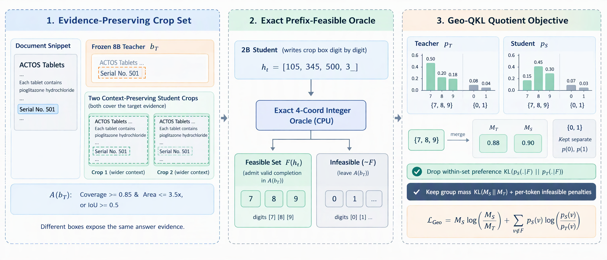
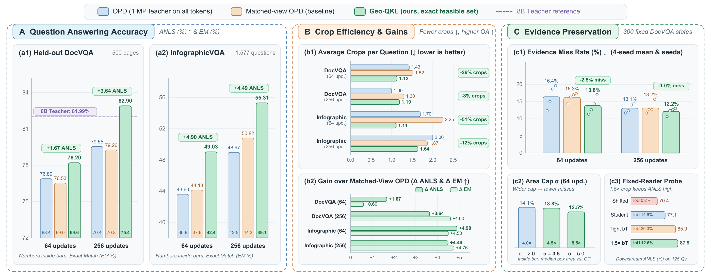

# Geo-QKL 中文详解：动机、方法与实验结果

> **论文题目**：*Crops as Evidence: Feasible-Set Distillation for Visual Document Agents*  
> **核心方法**：**Geo-QKL**（Geometric Quotient KL，基于精确几何可行集的在线策略蒸馏）

---

## 一、研究动机（Motivation）：为什么普通蒸馏在裁剪坐标上会失效？

### 1. 视觉文档智能体是怎么看图的？
面对一张高分辨率的文档（DocVQA）或细长密集的信息图（InfographicVQA），如果直接把整张图缩放到多模态大模型的全局概览预算（`0.25 MP`），图片里的小字、表格数字和角标就会模糊到无法辨认。  
因此，视觉智能体采用**“先全局概览、再局部裁剪”**的多轮交互方式：
1. 先看 `0.25 MP` 的低清全局图；
2. 输出一个裁剪工具调用 `<tool_call>{"name":"crop","arguments":{"bbox":[x1,y1,x2,y2]}}</tool_call>`（坐标在 `0..1000` 整数网格上，按数字逐个 token 生成）；
3. 从原图切出该区域的高清局部图（最高 `1.0 MP`）拼回上下文，最多裁剪 3 次后给出最终答案。

### 2. 无标注蒸馏的痛点：裁剪框不是检测框，而是“取证动作”
当我们想把一个强大的 **8B 教师模型（`Qwen3-VL-8B-Instruct`）** 的能力蒸馏给 **2B 学生模型（`Qwen3-VL-2B-Instruct`）**，且**不使用任何人工标注框或标准答案**时，标准的**在线策略蒸馏（On-Policy Distillation, OPD）**让学生自己采样生成轨迹，并最小化每个 token 上学生与教师分布的逆向 KL 散度。

然而，标准 OPD 把 `[x1, y1, x2, y2]` 的每一个坐标数字都当成普通文本来对齐，这带来了根本性的冲突：
- **答案证据具有空间多解性**：比如题目问“ACTOS 的序列号是多少？”，只框住 `"501"` 的紧框，和把左边字段名 `"Serial No. 501"` 甚至上下两行一起框进来的宽框，**都能让阅读器清清楚楚地读出正确答案 `501`**。
- **实验直接证实**：我们固定同一个 2B 阅读器，在 125 道 DocVQA 题上只改变裁剪框。结果发现：**把 8B 教师预测的紧框 $b_T$ 外扩 $1.5\times$（面积变为 $2.25\times$），它与人工标注证据框的 IoU 直接腰斩（从 `26.3%` 降到 `12.6%`），但答题准确率不仅没降，反而从 `85.9` 升到了 `87.9` ANLS**（与直接喂人工真值框的 `88.6` 持平）；相反，如果把同样面积的框平移偏离证据区，准确率会暴跌到 `70.4` ANLS。
- **Token 级 KL 的过度惩罚**：在逐数字的 Token 级 KL 下，学生只要写出了一个“外扩保留上下文的好框”，就会因为数字与教师的第一偏好不同而受到与“移偏丢证据的坏框”同样严厉的惩罚。

---

## 二、核心方法（Method）：Geo-QKL 是怎么解决的？

一句话概括：**我们不要求学生照抄教师偏好的那一组坐标数字，只要求学生的坐标落在“教师认为可接受的裁剪框集合”内。**

### 第一步：用教师参考框定义“可接受裁剪集合” $\mathcal{A}(b_T)$
在每个裁剪回合开始时，8B 教师根据学生当前的框前历史，在 `1.0 MP` 高清视图下贪心解码出一个参考框 $b_T$。如果候选框 $b=[x_1,y_1,x_2,y_2]$ 满足以下两个条件之一，就定义为**几何可接受（Acceptable）**：
$$\mathcal{A}(b_T) = \left\{ b \;\middle|\; \left(\frac{|b \cap b_T|}{|b_T|} \ge 0.85 \;\wedge\; \frac{|b|}{|b_T|} \le 3.5\right) \;\vee\; \mathrm{IoU}(b, b_T) \ge 0.5 \right\}$$
- **第一分支（覆盖率 $\ge 0.85$ 且面积 $\le 3.5\times$）**：允许学生框得比教师更宽以保留字段名、表头等上下文，同时用 $3.5\times$ 面积上限防止框得太大导致缩放后字迹模糊；
- **第二分支（$\mathrm{IoU} \ge 0.5$）**：允许紧框周围的小幅平移。

### 第二步：精确四坐标整数几何 Oracle（逐数字判定前缀可行集 $\mathcal{F}(h_t)$）
学生是一个数字一个数字地写出 `[x1, y1, x2, y2]` 的。当学生写到框内的某个部分前缀 $h_t$（例如已经写了 `[105, 345, 500, 3`）时，下一个数字 $v \in \{0,\dots,9\}$ 是否“可行”，取决于**后面还能不能补全出至少一个属于 $\mathcal{A}(b_T)$ 的合法框**：
$$\mathcal{F}(h_t) = \left\{ v \;\middle|\; \exists \text{ 合法后缀 } u, \text{ 使得 } \mathrm{parse}(h_t\,v\,u) \in \mathcal{A}(b_T) \right\}$$
- **为什么不能用几十个候选框去近似？** 我们在真实轨迹前缀上实测发现，用 13 个候选框构成的稀疏列表在 **84%** 的数字位置上只能给出空集或单个数字，且其空集中有 **56% 以上**其实是“假空集”（几何上明明有合法补全，只是不在那 13 个框里）。
- **我们的精确几何 Oracle（`geo_qkl/geo_feas.py`）**：利用整数网格上 $y$ 轴最优响应的**闭式区间解**和右边界 $x_2 \le t_{x_2}$ 的**非支配集（non-dominated set）性质**，在 CPU 上直接给出数学精确解。在 191,520 次子网格暴力穷举对比中误差为 **0**，在真实前缀的 **79.4%** 位置上识别出多可行数字集合。

### 第三步：商空间逆向 KL 损失（Geo-QKL Objective）
在每个坐标数字位置 $h_t$，令学生和教师分给可行集 $\mathcal{F}(h_t)$ 的总概率分别为：
$$M_S = \sum_{v \in \mathcal{F}(h_t)} p_S(v\mid h_t), \qquad M_T = \sum_{v \in \mathcal{F}(h_t)} p_T(v\mid h_t).$$
**Geo-QKL** 把所有可行下一数字合并为一个事件，定义损失为：
$$\mathcal{L}_{\text{Geo}}(h_t) = M_S \log \frac{M_S}{M_T} + \sum_{v \notin \mathcal{F}(h_t)} p_S(v\mid h_t) \log \frac{p_S(v\mid h_t)}{p_T(v\mid h_t)}.$$
根据 KL 散度的链式法则（Chain Rule），标准 Token 级 KL 可以精确拆成两项：
$$\mathrm{KL}(p_S \| p_T) = \mathcal{L}_{\text{Geo}}(h_t) + \underbrace{M_S\,\mathrm{KL}\big(p_S(\cdot\mid\mathcal{F}) \,\big\|\, p_T(\cdot\mid\mathcal{F})\big)}_{\text{被 Geo-QKL 精确移除的集合内偏好项}}.$$
这样做有三个极佳的性质：
1. **释放集合内任意偏好**：学生在可接受框之间怎么选（比如填 `7`、`8` 还是 `9`）完全自由，不受惩罚；
2. **保持可行总置信度对齐**：学生留在可行集内的总概率 $M_S$ 依然对齐教师的 $M_T$；
3. **严厉纠偏不可行方向**：对每一个会跳出可接受区域的数字 $v \notin \mathcal{F}(h_t)$，惩罚强度与标准 OPD 分毫不差。

此外，在非坐标的普通文本 token 上，我们采用视图对齐的 **Matched-view OPD**：让教师也用与学生完全相同的 `0.25 MP` 概览图打分（仅在坐标 token 上用 `1.0 MP` 视图），避免教师照着学生看不清的细节强迫学生输出。

---

## 三、实验结果（Results）：2B 学生反超 8B 教师，少裁剪反而更高分

我们在 949 张无标注 DocVQA 页面上训练 `Qwen3-VL-2B-Instruct`（仅训练语言层 LoRA），在完全独立的 **500 页 Held-out DocVQA**、**1,577 题 InfographicVQA**、**404 题开发集**以及 **4 个自然图像高分辨率基准**上评测：

### 1. 文档与信息图主实验结果
- **Held-out DocVQA（256 步）**：
  - 蒸馏前 2B 学生：`68.31` ANLS / `56.60` EM
  - 冻结 8B 教师：`81.99` ANLS / `73.00` EM（平均 `1.19` 次裁剪）
  - 标准 OPD：`79.55` ANLS / `70.40` EM
  - Matched-view OPD：`79.26` ANLS / `70.80` EM（平均 `1.30` 次裁剪）
  - **Geo-QKL (ours)**：**`82.90` ANLS / `75.40` EM**（平均 `1.19` 次裁剪）——比 Matched-view OPD 高出 **`+3.64` ANLS / `+4.60` EM**，并以 1/4 参数量**反超 8B 教师 `+0.91` ANLS / `+2.40` EM**！
- **InfographicVQA（细长密集信息图）**：
  - **64 步**：**`49.03` ANLS / `42.36` EM**，比 Matched-view OPD（`44.13`）高出 **`+4.90` ANLS**，且平均每题裁剪次数从 `2.25` 次降到 **`1.11` 次（减少 51% 工具调用）**。
  - **256 步**：**`55.31` ANLS / `49.08` EM**，比 Matched-view OPD（`50.82`）高出 **`+4.49` ANLS / `+4.76` EM**，比标准 OPD（`48.97`）高出 **`+6.34` ANLS / `+6.53` EM**。
- **多种子稳健性**：在 4 个随机种子（`{42, 17, 2026, 7}`）共 16 组配对对比中，Geo-QKL 在 ANLS 上 **15/16 为正**，在 EM 上 **16/16 全正**。

### 2. 核心消融结论（404 题开发集 & Held-out DocVQA）
1. **精确几何 Oracle vs. 稀疏候选集**：稀疏候选集（$\le 13$ 框）在开发集上仅得 `84.09` ANLS（比 Geo-QKL 的 **`87.61`** 低 `3.52` 分），在 Held-out 上低 `1.26` ANLS / `2.60` EM——说明概率聚合只有在集合算准时才有效。
2. **Geo-QKL vs. 统一把坐标损失乘 0.25**：统一降权在 256 步 Held-out 上仅得 `80.11` ANLS / `71.60` EM，落后 Geo-QKL **`2.79` ANLS / `3.80` EM**——说明必须只放松可行集内部，而不能削弱不可行方向的纠偏。
3. **Geo-QKL vs. 整框事后门控（Box-level Gate）**：事后门控在开发集上为 `85.80` ANLS，落后 Geo-QKL **`1.81` ANLS**——说明必须在逐数字生成的前缀阶段实时引导分布。
4. **出框行为变化（300 个固定状态探针）**：Geo-QKL 在 256 步下的**证据漏框率（Miss Rate）降至全方法最低的 `12.2%`**（基线为 `13.2%`–`13.7%`），预测框中位面积更宽裕（`4.82×` vs. `4.10×`），证明学生确实学会了用更稳健的宽框包住答题证据。
5. **自然图像高分辨率零样本迁移**：在未见过任何自然图像训练数据的情况下，迁移到 `V*`（**`55.0%`**）、`HR-Bench 4K`（`61.1%`）、`HR-Bench 8K`（`52.5%`）、`TreeBench`（**`33.1%`**）四个基准上取得 **`50.4%` 的最高平均准确率**。
